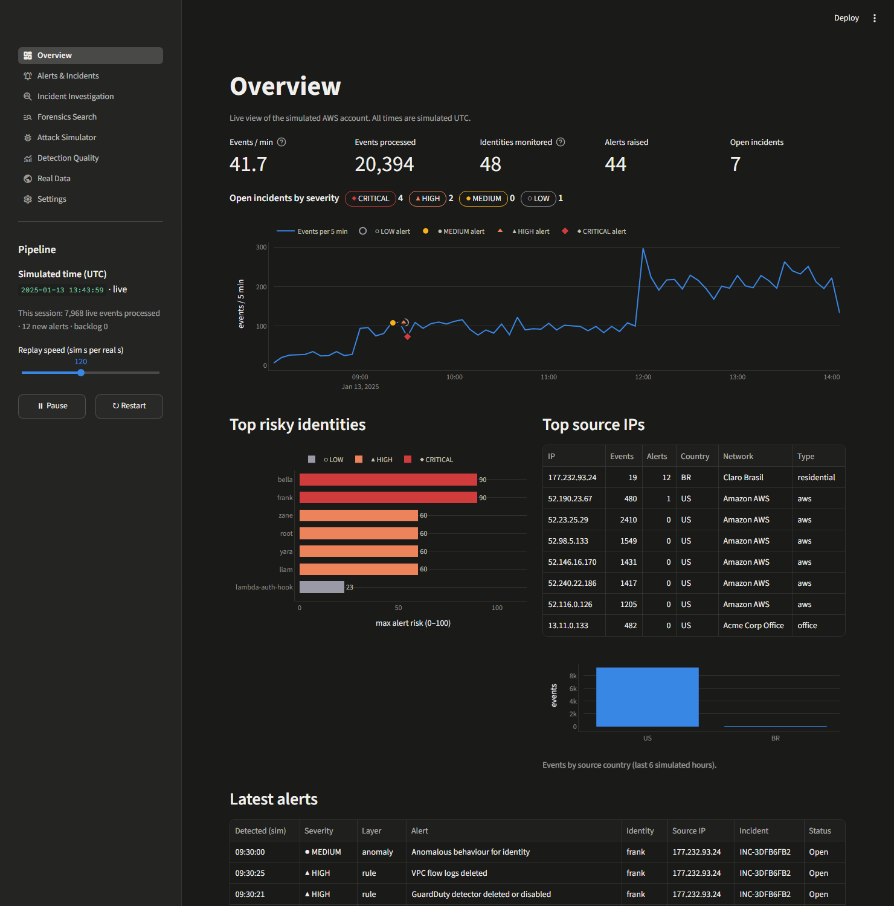

# Cloud Threat Detection

Defensive monitoring for **AWS CloudTrail**. It generates realistic synthetic audit logs with labeled attacks, detects threats with three layers (a rules engine, an **IsolationForest** behavioural model, and an IP/access-pattern layer), groups alerts into incidents with severity and a MITRE ATT&CK tactic chain, and gives an analyst a dashboard for triage, investigation and forensics.

It analyzes logs and never attacks anything. Everything is free and open source, runs on a laptop CPU, and **needs no AWS account**.



## Quick start

**With Docker** (nothing to train, no AWS account):

```bash
docker compose up
# open http://localhost:8501
```

The container ships a ~20 MB pre-trained demo (`demo/`), so the Overview, Incidents and Investigation pages are populated the moment it opens, and the simulated stream keeps running live from there. Open **Attack Simulator**, inject *Compromised access key → privilege escalation → disable CloudTrail*, and watch alerts, an incident and its MITRE chain appear within seconds.

**Without Docker** (Python 3.12):

```bash
python -m venv .venv && .venv/Scripts/activate        # Linux/macOS: source .venv/bin/activate
pip install -r requirements.txt
streamlit run app/streamlit_app.py
python -m pytest -q                                    # ~2 minutes
```

<!-- RESULTS:START -->
## Results at a glance

| Measure | Result |
| :--- | :--- |
| Attack stages detected (synthetic held-out week) | 100.0% of 84 |
| False-positive incidents per day (benign week) | 3.29 (0 HIGH or CRITICAL) |
| Kill chains grouped into one incident | 6/6 |
| Time to detect, median / p95 (simulated s) | 0 / 18.4 |
| Recall against a stealthy attacker | 86.9% at stealth 0.9 (from 100% at 0.0) |
| Live pipeline: event to alert (median) | 424 ms, 9/9 injections detected |
| **Real** Stratus techniques covered, original rules (held-out) | **12/35** (34%) |
| ...after adding rules for the gaps (post-hoc, not independent) | 33/35 (94%) |
| flaws.cloud 2019-08 surge (66.7× normal volume) | detected; 100.0% of its events covered |

Generated from `reports/*.json`. Synthetic numbers are optimistic (the detectors and generator share an author); the real-data rows are the honest ones. See [`docs/RESULTS.md`](docs/RESULTS.md) and [`docs/REAL_DATA_FINDINGS.md`](docs/REAL_DATA_FINDINGS.md).
<!-- RESULTS:END -->

## How it works

```
 generator (benign personas + labeled attacks S1-S9)  --live injection-->  queue  -->  detector
                                                                                         |-- rules (YAML, per event, windowed thresholds)
                                                                                         |-- identity x 15-min windows -> IsolationForest (+ SHAP reasons)
                                                                                         |-- IP layer (impossible travel, shared IP, many IPs, blocklist)
                                                                                         v
                                              scoring -> alerts -> incidents (MITRE chain, severity, status)  --> DuckDB --> Streamlit
```

- **Labels never reach the detectors.** Ground truth lives in a separate table and is read only by evaluation code; tests enforce it.
- **Per-identity baselines.** Features such as "new IP/country/user agent/region" and "unusual hour" are relative to what each identity normally does.
- **Replay speed does not change results.** The detector is driven by event time, not the wall clock (tested at 0 and 20,000× speed).
- **Real exports are supported.** `scripts/ingest_cloudtrail.py` ingests any CloudTrail export (`.json`, `.json.gz`, tar) into the same tables. No AWS SDK or credentials are used anywhere in this project.

## Real-data validation, including where it fell short

The synthetic numbers above are optimistic because the detectors and the generator share an author. So the project is also run against logs it did not generate (details in [`docs/REAL_DATA_FINDINGS.md`](docs/REAL_DATA_FINDINGS.md)):

- **Stratus Red Team** captures of 35 real techniques: the original rules covered only about a third. Two shipped rules were wrong on real record shapes. Seventeen rules were added afterwards, so the improved number is a *post-hoc* regression check, not an independent measurement.
- **flaws.cloud** (about 1.2M unique real events, 37% of the published records were exact duplicates): an August 2019 volume surge found from raw counts is detected by both rules and the anomaly model trained only on earlier history. Real traffic also exposed alert floods and a false-positive source, both fixed.
- **Invictus-IR** and the **SANS S3 ransomware lab**: rule hits and the gaps they revealed.

## Commands

| Task | Command |
|---|---|
| Run the dashboard | `streamlit run app/streamlit_app.py` |
| Run tests | `python -m pytest -q` |
| Generate data | `python scripts/generate.py --days 7 --attacks S1,S3 --count 3 --out data/week.duckdb` |
| Train the models | `python scripts/train.py` |
| Evaluate (ablations, per-scenario P/R/F1) | `python scripts/evaluate.py --cache` |
| Stealth robustness study | `python scripts/robustness.py` |
| Live pipeline, headless | `python scripts/run_live.py --speed 150 --sim-hours 3 --inject S1+S2+S3+S4+S5@1500` |
| Ingest your own CloudTrail export | `python scripts/ingest_cloudtrail.py PATH --out data/mine.duckdb` |
| Real data: flaws.cloud | `python scripts/load_flaws.py` then `python scripts/validate_real.py` |
| Regenerate the docs and this table | `python scripts/make_results.py` |
| Rebuild the demo snapshot | `python scripts/build_demo.py` |
| Build the static showcase site | `python scripts/build_showcase.py` |

`docs/RESULTS.md`, `docs/DETECTIONS.md` and `docs/REAL_DATA_FINDINGS.md` are **generated** from the measured reports. Never edit them by hand.

## Security notes

The dashboard is a local analyst tool and has **no authentication**. `docker compose` therefore publishes it on `127.0.0.1` only; do not expose it to an untrusted network without an authenticating proxy in front. The analyst SQL box is restricted by an allowlist (only `events`, `alerts` and `incidents`; no file, environment or system access) with a row cap and a timeout. See [`SECURITY.md`](SECURITY.md) for the trust model and how to report a problem.

## Optional alerting

The **Settings** page can send HIGH/CRITICAL alerts to a free Discord or Slack incoming webhook (or any URL accepting a JSON POST). It is off by default, rate-limited, can never stall detection, and only accepts `http(s)` URLs. Prefer the `CTD_WEBHOOK_URL` environment variable so the URL is never written to a file. Alert details leave your machine when you enable it.

## Static showcase

`python scripts/build_showcase.py` builds `site/`, a static results page (no server, no hosted Streamlit). A GitHub Pages workflow is included; enable *Settings → Pages → Source: GitHub Actions* once in your repository.

## Layout

```
config/    org personas, attack scenarios, detector + scoring settings, response playbook
rules/     YAML detection rules (R001-R041)
src/       generator/ detection/ pipeline/ (live engine, ingest, storage) integrations/ (webhook)
app/       Streamlit dashboard (pages/) and its data layer
scripts/   generate, train, evaluate, robustness, run_live, validate_real, make_results, build_demo, build_showcase
demo/      committed ~20 MB pre-trained models + recorded snapshot (the offline demo)
reports/   measured metrics (JSON) that every doc is generated from
docs/      RESULTS.md, DETECTIONS.md, REAL_DATA_FINDINGS.md, screenshots/
tests/     ~200 tests: rules fixtures, features, live engine, dashboard pages, ingestion, webhook
```

## Limitations

- The detectors were developed against the same synthetic world used to evaluate them; treat synthetic metrics as an upper bound. Per-scenario precision is one-vs-rest against a shared benign background and depends on how many attacks were injected.
- The anomaly threshold is calibrated on a benign week and does not carry over to a different regime without recalibration (visible on flaws.cloud).
- Geolocation uses a synthetic registry for generated data and is switched off for real data (public datasets anonymize IPs). Plug in DB-IP Lite (free, CC BY 4.0) to use real geography on your own logs.
- The stealth study models specific evasions (user agent, region/country, hours, pace). Real adversaries vary in other ways, and an attacker who stays read-only and low-volume is not modeled.

## Data sources and credits

- flaws.cloud CloudTrail dataset, Scott Piper / Summit Route: <https://summitroute.com/blog/2020/10/09/public_dataset_of_cloudtrail_logs_from_flaws_cloud/> (IPs and account IDs anonymized by the publisher).
- Sample logs from Stratus Red Team (Datadog), Invictus-IR, and the SANS 504 S3 ransomware lab, as redistributed in [Yamato-Security/suzaku-sample-data](https://github.com/Yamato-Security/suzaku-sample-data). These are downloaded for validation and are **not** committed here.
- MITRE ATT&CK® is a registered trademark of The MITRE Corporation.

## License

The code in this repository is released under the [MIT License](LICENSE). The public datasets listed above are **not** covered by it and keep their own terms; they are downloaded for validation and are not redistributed here.
